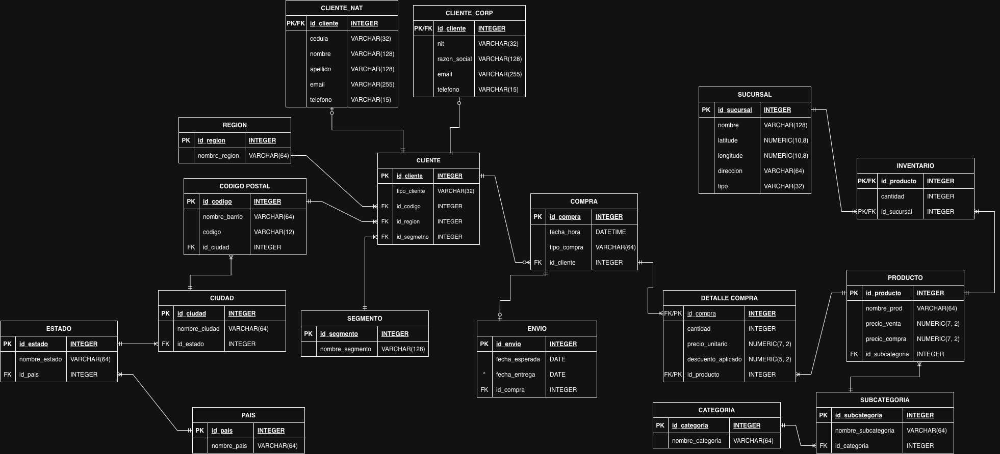

<div style="width:100%; background-color:#00522c; border-bottom:3px solid #34a853; padding:20px 0; text-align:center;">
  
</div>

# Diseño de una base de datos relacional para un supermercado

**Normalización, control de redundancia e integridad referencial**

Proyecto final de **Bases de Datos** · Universidad Externado de Colombia · Departamento de Matemáticas, Ciencia de Datos.

| | |
|---|---|
| **Autores** | Juan Pablo Carrillo Hortua, Samuel Acosta Morales |
| **Docente** | Ing. Martha Liliana Quevedo |
| **Caso de estudio** | Mercados Nova (cadena de supermercados) |
| **Motor principal** | PostgreSQL (base de datos `supermercado`) |

## Contenido

1. [Introducción](#1-introducción)
2. [Estructura](#2-estructura)
3. [Paso a paso](#3-paso-a-paso)
   - [3.1 Requisitos](#31-requisitos) · [3.2 Obtener el proyecto](#32-obtener-el-proyecto) · [3.3 Preparar el entorno de Python](#33-preparar-el-entorno-de-python) · [3.4 Preparar psql](#34-preparar-psql)
   - [3.5 Crear la base de datos y el esquema](#35-crear-la-base-de-datos-y-el-esquema) · [3.6 Cargar los datos](#36-cargar-los-datos) · [3.7 Verificar la carga](#37-verificar-la-carga) · [3.8 Ejecutar las consultas de negocio](#38-ejecutar-las-consultas-de-negocio)
   - [3.9 Transacción de compra](#39-transacción-de-compra) · [3.10 Optimización con índices](#310-optimización-con-índices) · [3.11 MongoDB (opcional)](#311-mongodb-opcional) · [3.12 Problemas frecuentes](#312-problemas-frecuentes)

---

## 1. Introducción

### 1.1 Problema

Mercados Nova guarda toda su operación comercial (ventas, clientes, productos, órdenes y envíos) en **un único registro masivo**. Esa mezcla provoca que unos datos dependan erróneamente de otros:

- La fecha del pedido, el cliente y el modo de envío dependen solo del número de orden.
- El nombre, la categoría y la subcategoría de un producto dependen solo del identificador del producto.
- Dependencias transitivas: el código de cliente determina su nombre y segmento, y el código postal determina la ciudad y el departamento.

Con esa estructura la tabla cumple la primera forma normal, pero incumple la segunda, la tercera y la de Boyce-Codd, y cualquier actualización obliga a modificar registros completos con riesgo de inconsistencias. El planteamiento completo está en [`formulacion_problema/planteamiento problema bases de datos.pdf`](formulacion_problema/planteamiento%20problema%20bases%20de%20datos.pdf).

### 1.2 Solución

Se diseñó una **base de datos relacional normalizada** (3FN y BCNF) que:

- Separa las entidades del negocio: compra, detalle de compra, envío, cliente (natural o corporativo), segmento, región, ubicación (país → departamento → ciudad → código postal), producto (producto → subcategoría → categoría), sucursal e inventario.
- Garantiza integridad con llaves primarias y foráneas, restricciones `CHECK` y disparadores (*triggers*).
- Permite responder las **10 preguntas de información** del planteamiento mediante vistas, funciones y procedimientos almacenados.
- Incluye una **transacción** para registrar compras, un ejercicio de **optimización con índices** y una migración del catálogo de productos a **MongoDB**.

**Alcance.** Registro de ventas en línea y presenciales con su detalle, administración y segmentación de clientes, control de inventario por producto y sucursal, y gestión de envíos (fecha esperada y fecha final de entrega). No se incluyen transportistas ni proveedores, pero el diseño normalizado permite agregarlos después.

**Datos.** Se parte del dataset [Superstore](https://www.kaggle.com/datasets/vivek468/superstore-dataset-final) de Kaggle (9.994 filas y 21 columnas). Lo que el dataset no tiene (canal de venta, sucursales, inventario, documentos de los clientes) se **simula** con semillas fijas, y la geografía de EE. UU. se reemplaza por una geografía colombiana.

### 1.3 Modelo de datos

**Diagrama entidad–relación** ([`ER/`](ER/)):


**Modelo relacional** ([`diseno_modelo_relacional/`](diseno_modelo_relacional/)). La justificación de 1FN, 2FN, 3FN y BCNF y la tabla de llaves está en [`diseno_modelo_relacional/README.md`](diseno_modelo_relacional/README.md):



### 1.4 Reglas de negocio y cómo se garantizan

| # | Regla (resumen) | Implementación |
|---|---|---|
| 1 | Una compra solo tiene envío si fue virtual | *Trigger* `validar_envio_compra` sobre `envio` |
| 2 | Fecha esperada y fecha de entrega final separadas | `envio.fecha_esperada` (obligatoria) y `envio.fecha_entrega` (nula hasta entregar) |
| 3 | Un cliente pertenece a un solo segmento | `cliente.id_segmento` (FK, obligatoria) |
| 4 | Un cliente tiene varias compras; una compra, un cliente | `compra.id_cliente` (FK) |
| 5 | Precios mayores que cero | `CHECK (precio_venta > 0)` y `CHECK (precio_compra > 0)` en `producto` |
| 6 | Cantidad por producto en cada compra | `detalle_compra.cantidad` con `CHECK (cantidad > 0)` |
| 7 | Estado → país, ciudad → estado, código postal → ciudad, cliente → código postal | Cadena de FK `pais` ← `estado_departamento` ← `ciudad` ← `codigo_postal` ← `cliente` |
| 8 | El total de la compra es la suma de sus líneas | No se almacena: se calcula con la vista `v_lineas_venta` |
| 9 | Producto → una subcategoría → una categoría | FK `producto.id_subcategoria` y `subcategoria.id_categoria` |
| 10 | Una compra con varios productos; un producto en varias compras | Llave primaria compuesta `(id_compra, id_producto)` en `detalle_compra` |
| 11 | Inventario por producto y sucursal, nunca negativo | PK `(id_producto, id_sucursal)` y `CHECK (cantidad >= 0)` en `inventario` |
| 12 | Toda compra registra su canal y sucursal (virtual → bodega, presencial → tienda) | `compra.tipo_compra`, `sucursal.tipo` y *trigger* `validar_sucursal_compra` |

### 1.5 Herramientas utilizadas

| Herramienta | Uso en el proyecto |
|---|---|
| **PostgreSQL 18** (`psql`, PL/pgSQL) | Esquema, *triggers*, vistas, funciones, procedimientos, transacción e índices |
| **Python 3.11 o superior** | Generador de datos, llamada a la transacción y migración a MongoDB |
| **pandas**, **kagglehub**, **Jupyter** | Exploración del dataset original y generación del script de inserción |
| **SQLAlchemy**, **psycopg 3**, **pydantic**, **pydantic-settings** | Conexión a PostgreSQL y lectura de la configuración (`config.py`, `.env`) |
| **MongoDB**, **mongosh**, **pymongo** | Catálogo de productos como base documental |
| **draw.io** | Diagramas ER y relacional (archivos `.drawio`) |
| **Git** | Control de versiones |

---

## 2. Estructura

El repositorio sigue el orden del trabajo: planteamiento → modelo ER → modelo relacional → implementación → consultas → transacciones y optimización → MongoDB.

```text
proyecto-final-db-UEC/
├── README.md                                   Este documento
├── LICENSE.txt
├── CLAUDE.md                                   Guía de contexto para Claude Code
├── config.py                                   Configuración (lee las variables de .env)
├── requirements.txt                            Dependencias de Python (pip install -r)
├── .env.example                                Plantilla de variables de entorno
│
├── formulacion_problema/
│   └── planteamiento problema bases de datos.pdf
│
├── ER/
│   ├── ER proyecto bd.drawio                   Fuente editable
│   └── ER proyecto bd.png
│
├── diseno_modelo_relacional/
│   ├── README.md                               Normalización (1FN-BCNF) y tabla de PK/FK
│   ├── Diseno_modelo_relacional.drawio         Fuente editable
│   └── Diseno_modelo_relacional.png
│
├── implementar_en_postgreSQL/
│   ├── db/
│   │   ├── create_tables.sql                   Esquema: tablas, vista v_clientes y triggers
│   │   ├── generar_insert_data.py              Genera insert_data.sql desde el CSV
│   │   ├── insert_data.sql                     Datos listos para cargar (generado)
│   │   └── backup_supermercado.sql             Copia de respaldo (pg_dump)
│   └── queries/
│       ├── README.md                           Relación pregunta ↔ consulta
│       ├── preguntas_negocio.sql               Vistas, funciones y procedimientos (10 preguntas)
│       └── ejemplo_llamadas.sql                Ejemplo de llamada a cada objeto
│
├── optimizacion_transacciones/
│   ├── transacciones/
│   │   ├── README.md                           ACID, concurrencia y aislamiento
│   │   ├── transacciones.sql                   Procedimiento comprar()
│   │   └── llamar_transaccion.py               Llamada al procedimiento desde Python
│   └── optimizacion/
│       ├── queries_optimization.sql            EXPLAIN ANALYZE e índices propuestos
│       └── metricas_pre_post_optim/            Resultados antes y después de optimizar
│
├── mongo_db/
│   ├── schemas.js                              Colecciones, validación e índices (mongosh)
│   └── insertions/
│       ├── schemas.py                          Modelos pydantic
│       └── insertions.py                       Migración PostgreSQL → MongoDB
│
├── notebooks/
│   └── original_data.ipynb                     Descarga y exploración del dataset original
│
└── data/                                       No versionada: aquí va el CSV de Kaggle
```

### Qué hace cada parte

| Carpeta o archivo | Contenido |
|---|---|
| [`formulacion_problema/`](formulacion_problema/) | Contexto, problema, propósito, alcance, reglas de negocio y las 10 preguntas de información |
| [`ER/`](ER/) | Diagrama entidad–relación |
| [`diseno_modelo_relacional/`](diseno_modelo_relacional/) | Modelo relacional y argumento de normalización |
| [`implementar_en_postgreSQL/db/`](implementar_en_postgreSQL/db/) | Creación del esquema y carga de datos |
| [`implementar_en_postgreSQL/queries/`](implementar_en_postgreSQL/queries/) | Respuesta a cada pregunta de información; el [README](implementar_en_postgreSQL/queries/README.md) indica qué objeto resuelve cuál |
| [`optimizacion_transacciones/`](optimizacion_transacciones/) | Transacción de compra (ACID) y optimización con índices |
| [`mongo_db/`](mongo_db/) | Catálogo de productos (categorías, subcategorías y productos) en MongoDB |
| [`notebooks/`](notebooks/) | Análisis del dataset original frente al esquema (dependencias funcionales) |

### Tablas del esquema

| Grupo | Tablas |
|---|---|
| Ubicación | `pais`, `estado_departamento`, `ciudad`, `codigo_postal`, `region` |
| Clientes | `segmento`, `cliente`, `cliente_nat` (cédula), `cliente_corp` (NIT), vista `v_clientes` |
| Ventas | `compra`, `detalle_compra`, `envio` |
| Catálogo | `categoria`, `subcategoria`, `producto` |
| Operación | `sucursal` (tipo `TIENDA` o `BODEGA`), `inventario` |

---

## 3. Paso a paso

Esta sección instala lo necesario para **revisar y calificar el proyecto** y explica cada herramienta. Los comandos están escritos para **Windows PowerShell** (la terminal de VS Code); al final de [3.4](#34-preparar-psql) hay un cuadro con los equivalentes para Linux y macOS.

> **Ruta rápida para calificar.** Basta con PostgreSQL y Git: pasos 3.1, 3.2 y 3.4 a 3.8. Los demás son opcionales: 3.3 prepara Python (solo hace falta para llamar la transacción desde Python en 3.9 y para MongoDB en 3.11), y 3.9 y 3.10 profundizan en transacciones y optimización.

### 3.1 Requisitos

| Herramienta | Versión | ¿Para qué? | ¿Obligatoria? |
|---|---|---|---|
| [Git](https://git-scm.com/downloads) | cualquiera | Clonar el repositorio | Sí |
| [PostgreSQL](https://www.postgresql.org/download/) (incluye `psql`) | 18 (el respaldo se generó con la 18.6) | Crear y consultar la base de datos | Sí |
| [Python](https://www.python.org/downloads/) | 3.11 o superior (probado con 3.14) | Transacción desde Python, MongoDB, generador de datos y cuaderno | Solo pasos 3.3, 3.9 (llamada desde Python) y 3.11 |
| [MongoDB Community Server](https://www.mongodb.com/try/download/community) y [mongosh](https://www.mongodb.com/try/download/shell) | reciente | Catálogo en MongoDB | Solo paso 3.11 |
| [draw.io](https://www.drawio.com/) o la extensión de VS Code | cualquiera | Abrir los `.drawio` | No (hay `.png`) |

Comprobar lo instalado:

```powershell
git --version
python --version
```

### 3.2 Obtener el proyecto

```powershell
git clone https://github.com/juanpablocarrillohortua/proyecto-final-db-UEC.git
cd proyecto-final-db-UEC
```

Todos los comandos siguientes se ejecutan **desde esta carpeta** (la raíz del repositorio).

### 3.3 Preparar el entorno de Python

Los scripts de Python del proyecto (transacción de compra, migración a MongoDB, generador de datos y cuaderno) usan las librerías de [`requirements.txt`](requirements.txt). Este paso se hace **una sola vez**, justo después de clonar, porque necesita los archivos `requirements.txt` y `.env.example` del repositorio. Si solo va a revisar la base de datos en PostgreSQL, puede saltarlo.

```powershell
Copy-Item .env.example .env
notepad .env        # escriba la contraseña en POSTGRES_PASSWORD
python -m venv .venv
.\.venv\Scripts\Activate.ps1
pip install -r requirements.txt
```

- **`.env`** guarda la conexión que lee `config.py`. Las variables vacías toman su valor por defecto: PostgreSQL en `localhost:5432`, usuario `postgres`, base `supermercado`; MongoDB en `localhost:27017`, sin autenticación, base `product_catalog`. Solo es obligatorio escribir `POSTGRES_PASSWORD`. El archivo está en `.gitignore`, por lo que no se sube al repositorio.
- **`.venv`** es un entorno virtual: instala las librerías solo para este proyecto, sin tocar el Python del sistema. Cuando está activo, el prompt empieza con `(.venv)`; hay que activarlo de nuevo en cada terminal nueva.
- **`pip install -r requirements.txt`** instala de una vez todas las librerías:

| Librería | ¿Para qué? |
|---|---|
| `sqlalchemy` y `psycopg[binary]` | Conectarse a PostgreSQL (transacción de compra y migración a MongoDB) |
| `pydantic` y `pydantic-settings` | Validar los datos de la migración y leer `.env` en `config.py` |
| `pymongo` | Conectarse a MongoDB |
| `pandas` | Generador de datos (`generar_insert_data.py`) y cuaderno de exploración |
| `kagglehub` | Descargar el dataset original desde el cuaderno |
| `ipykernel` | Ejecutar el cuaderno en VS Code |

En Linux o macOS:

```bash
cp .env.example .env
python3 -m venv .venv
source .venv/bin/activate
pip install -r requirements.txt
```

### 3.4 Preparar psql

En Windows, el instalador de PostgreSQL no agrega `psql` al `PATH`. Agréguelo solo para la terminal actual (cambie `18` si instaló otra versión) y fije la codificación para que las tildes se lean bien:

```powershell
$env:Path += ";C:\Program Files\PostgreSQL\18\bin"
$env:PGCLIENTENCODING = "UTF8"
psql --version
```

Opcional: para que `psql` no pida la contraseña de `postgres` en cada comando:

```powershell
$env:PGPASSWORD = "su_contraseña"
```

Esto debe repetirse cada vez que se abra una terminal nueva.

| Windows PowerShell | Linux / macOS (bash) |
|---|---|
| `$env:Path += ";C:\Program Files\PostgreSQL\18\bin"` | `psql` normalmente ya está en el `PATH` |
| `$env:PGCLIENTENCODING = "UTF8"` | `export PGCLIENTENCODING=UTF8` |
| `.\.venv\Scripts\Activate.ps1` | `source .venv/bin/activate` |
| `$env:PYTHONPATH = "."` | `export PYTHONPATH=.` |
| `'{\"10\": [5.0, 1]}'` (argumento JSON en PowerShell 5.1) | `'{"10": [5.0, 1]}'` |

### 3.5 Crear la base de datos y el esquema

```powershell
psql -U postgres -h localhost -c "CREATE DATABASE supermercado"
psql -U postgres -h localhost -d supermercado -v ON_ERROR_STOP=1 -f implementar_en_postgreSQL/db/create_tables.sql
```

`create_tables.sql` crea las 17 tablas, la vista `v_clientes` (con su *trigger* `INSTEAD OF INSERT`) y los *triggers* de las reglas 1 y 12. Debe ejecutarse **una sola vez** sobre una base vacía.

### 3.6 Cargar los datos

**Opción A (recomendada): script de inserción.** Vacía las tablas, reinicia los identificadores y carga todo dentro de una transacción, por lo que puede repetirse sin problema:

```powershell
psql -U postgres -h localhost -d supermercado -v ON_ERROR_STOP=1 -f implementar_en_postgreSQL/db/insert_data.sql
```

**Opción B (atajo): restaurar el respaldo.** Sirve en lugar de los pasos 3.5 y 3.6 y debe hacerse sobre una base **vacía** (solo `CREATE DATABASE`, sin `create_tables.sql`). El archivo `backup_supermercado.sql` está guardado en UTF-16 y `psql` no lo lee directamente, así que primero se convierte una copia a UTF-8 en la carpeta temporal, sin modificar el repositorio:

```powershell
psql -U postgres -h localhost -c "CREATE DATABASE supermercado"

$origen  = "implementar_en_postgreSQL\db\backup_supermercado.sql"
$destino = Join-Path $env:TEMP "backup_supermercado_utf8.sql"
$texto = [System.IO.File]::ReadAllText((Resolve-Path $origen), [System.Text.Encoding]::Unicode)
[System.IO.File]::WriteAllText($destino, $texto, (New-Object System.Text.UTF8Encoding $false))

psql -U postgres -h localhost -d supermercado -v ON_ERROR_STOP=1 -f $destino
Remove-Item $destino
```

El respaldo contiene el esquema, los datos, las vistas y funciones de [3.8](#38-ejecutar-las-consultas-de-negocio) y el procedimiento `ventas_segmento`. **No** incluye el procedimiento `comprar` ni los índices: para ellos siga los pasos 3.9 y 3.10.

En Linux o macOS la conversión es `iconv -f UTF-16 -t UTF-8 implementar_en_postgreSQL/db/backup_supermercado.sql > /tmp/backup_utf8.sql`.

### 3.7 Verificar la carga

Abra una sesión de `psql`:

```powershell
psql -U postgres -h localhost -d supermercado
```

Pegue esta consulta:

```sql
SELECT 'pais' AS tabla, COUNT(*) AS filas FROM pais
UNION ALL SELECT 'estado_departamento', COUNT(*) FROM estado_departamento
UNION ALL SELECT 'ciudad', COUNT(*) FROM ciudad
UNION ALL SELECT 'codigo_postal', COUNT(*) FROM codigo_postal
UNION ALL SELECT 'region', COUNT(*) FROM region
UNION ALL SELECT 'segmento', COUNT(*) FROM segmento
UNION ALL SELECT 'cliente', COUNT(*) FROM cliente
UNION ALL SELECT 'cliente_nat', COUNT(*) FROM cliente_nat
UNION ALL SELECT 'cliente_corp', COUNT(*) FROM cliente_corp
UNION ALL SELECT 'categoria', COUNT(*) FROM categoria
UNION ALL SELECT 'subcategoria', COUNT(*) FROM subcategoria
UNION ALL SELECT 'producto', COUNT(*) FROM producto
UNION ALL SELECT 'sucursal', COUNT(*) FROM sucursal
UNION ALL SELECT 'inventario', COUNT(*) FROM inventario
UNION ALL SELECT 'compra', COUNT(*) FROM compra
UNION ALL SELECT 'detalle_compra', COUNT(*) FROM detalle_compra
UNION ALL SELECT 'envio', COUNT(*) FROM envio;
```

Resultado esperado justo después de cargar los datos (antes de registrar compras nuevas en 3.9):

| tabla | filas | | tabla | filas |
|---|---:|---|---|---:|
| pais | 1 | | producto | 1850 |
| estado_departamento | 26 | | sucursal | 16 |
| ciudad | 67 | | inventario | 29600 |
| codigo_postal | 632 | | compra | 5009 |
| region | 4 | | detalle_compra | 9986 |
| segmento | 3 | | envio | 1987 |
| cliente | 793 | | categoria | 3 |
| cliente_nat | 557 | | subcategoria | 17 |
| cliente_corp | 236 | | | |

Para salir de `psql` escriba `\q`.

### 3.8 Ejecutar las consultas de negocio

`preguntas_negocio.sql` crea las vistas, funciones y procedimientos que responden las 10 preguntas del planteamiento (el script borra y recrea los objetos, por lo que puede repetirse). Después, `ejemplo_llamadas.sql` los invoca todos:

```powershell
psql -U postgres -h localhost -d supermercado -v ON_ERROR_STOP=1 -f implementar_en_postgreSQL/queries/preguntas_negocio.sql
psql -U postgres -h localhost -d supermercado -P pager=off -f implementar_en_postgreSQL/queries/ejemplo_llamadas.sql
```

También se pueden llamar de a uno dentro de `psql`:

```sql
-- Pregunta 1: evolución de ganancias y pérdidas ('anio', 'trimestre' o 'mes')
SELECT * FROM evolucion_periodo('anio');

-- Pregunta 2: productos más vendidos por temporada
SELECT * FROM v_productos_temporada;

-- Pregunta 3: tiempo de entrega real frente al esperado
SELECT * FROM v_entrega_por_bodega;

-- Pregunta 4: ventas por ubicación ('pais', 'estado', 'ciudad' o 'codigo_postal')
SELECT * FROM ventas_por_ubicacion('estado');

-- Pregunta 5: ventas y utilidad por segmento (procedimiento)
CALL ventas_segmento('Consumer', NULL, NULL, NULL, NULL);
```

La tabla que relaciona cada pregunta con su vista, función o procedimiento está en [`implementar_en_postgreSQL/queries/README.md`](implementar_en_postgreSQL/queries/README.md).

### 3.9 Transacción de compra

El procedimiento `comprar()` registra la compra, sus detalles y descuenta el inventario como una sola unidad: si algo falla, no queda ningún cambio. La explicación de ACID, concurrencia y aislamiento está en [`optimizacion_transacciones/transacciones/README.md`](optimizacion_transacciones/transacciones/README.md).

**Crear el procedimiento:**

```powershell
psql -U postgres -h localhost -d supermercado -v ON_ERROR_STOP=1 -f optimizacion_transacciones/transacciones/transacciones.sql
```

**Llamarlo desde SQL** (dentro de `psql`). El tercer argumento es un JSON con la forma `{id_producto: [descuento, cantidad]}`:

```sql
-- Compra presencial en la tienda 1
CALL comprar(100, 1, '{"10": [10.00, 2], "25": [0.00, 3]}'::jsonb, 'PRESENCIAL');

-- Compra online: debe hacerse desde una bodega (sucursales 4, 8, 12 o 16)
CALL comprar(100, 4, '{"10": [5.0, 1]}'::jsonb, 'ONLINE');
```

Por la regla 12, una compra `ONLINE` solo se acepta en una sucursal de tipo `BODEGA` y una `PRESENCIAL` solo en una `TIENDA`. Para ver los tipos:

```sql
SELECT id_sucursal, nombre, tipo FROM sucursal ORDER BY id_sucursal;
```

**Llamarlo desde Python.** Requiere el entorno de [3.3](#33-preparar-el-entorno-de-python) activo (`(.venv)` en el prompt) y la contraseña escrita en `.env`. Ejecute los scripts **desde la raíz del repositorio** y con `PYTHONPATH` apuntando a ella, porque importan `config.py`:

```powershell
$env:PYTHONPATH = "."

# Compra de ejemplo (cliente 100, sucursal 1, presencial)
python optimizacion_transacciones/transacciones/llamar_transaccion.py

# Con parámetros: id_cliente id_sucursal carrito tipo_compra
python optimizacion_transacciones/transacciones/llamar_transaccion.py 100 4 '{\"10\": [5.0, 1]}' ONLINE
```

Al terminar bien imprime `Ejecucion exitosa.`; si la transacción falla (por ejemplo, una compra `ONLINE` en una tienda), imprime el error y no se guarda nada. Las barras `\"` del JSON son necesarias en Windows PowerShell 5.1; en PowerShell 7 o bash se escribe `'{"10": [5.0, 1]}'`.

### 3.10 Optimización con índices

`queries_optimization.sql` analiza con `EXPLAIN ANALYZE` dos consultas, propone dos índices (`idx_detalle_compra_covering` e `idx_compra_fecha_cliente`) y vuelve a analizarlas. Requiere haber ejecutado [3.8](#38-ejecutar-las-consultas-de-negocio) (usa la vista `v_lineas_venta`) y debe correrse **una sola vez**, porque crea los índices:

```powershell
psql -U postgres -h localhost -d supermercado -P pager=off -f optimizacion_transacciones/optimizacion/queries_optimization.sql
```

Los resultados comparados de los planes antes y después están en [`resultados_consulta_1.md`](optimizacion_transacciones/optimizacion/metricas_pre_post_optim/resultados_consulta_1.md) y [`resultados_consulta_2.md`](optimizacion_transacciones/optimizacion/metricas_pre_post_optim/resultados_consulta_2.md).

### 3.11 MongoDB (opcional)

Migra el catálogo (categorías, subcategorías y productos) de PostgreSQL a MongoDB. Requiere MongoDB en ejecución, el entorno de Python de [3.3](#33-preparar-el-entorno-de-python) activo y los datos de PostgreSQL ya cargados. Por defecto se conecta a `localhost:27017`, sin autenticación, y usa la base `product_catalog`; para cambiarlo edite las variables `MONGO_*` de `.env`.

```powershell
# 1. Crear las colecciones, la validación JSON Schema y los índices
mongosh --file mongo_db/schemas.js

# 2. Copiar los datos desde PostgreSQL (desde la raíz del repositorio)
$env:PYTHONPATH = "."
python mongo_db/insertions/insertions.py
```

El segundo comando imprime cuántos documentos insertó en `categorias`, `subcategorias` y `productos`. Los índices únicos hacen que se pueda repetir sin duplicar documentos.

### 3.12 Problemas frecuentes

| Síntoma | Causa y solución |
|---|---|
| `psql` no se reconoce como comando | Falta agregarlo al `PATH` de la terminal: vea [3.4](#34-preparar-psql) |
| `password authentication failed` | La contraseña del usuario `postgres` es incorrecta (la definió al instalar PostgreSQL) |
| `Connection refused` | El servicio está detenido. En PowerShell como administrador: `Start-Service postgresql-x64-18` (si no lo encuentra, `Get-Service postgresql*`) |
| Tildes o caracteres extraños (`Bogot├í`) | Ejecute `$env:PGCLIENTENCODING = "UTF8"` y, si persiste, `chcp 65001` |
| `relation ... already exists` al crear el esquema | `create_tables.sql` ya se ejecutó. Borre la base con `psql -U postgres -h localhost -d postgres -c "DROP DATABASE IF EXISTS supermercado"` (elimina esquema y datos) y repita desde [3.5](#35-crear-la-base-de-datos-y-el-esquema) |
| `invalid byte sequence for encoding "UTF8"` al restaurar el respaldo | El respaldo está en UTF-16: conviértalo como se indica en [3.6](#36-cargar-los-datos), Opción B |
| `ModuleNotFoundError: No module named 'sqlalchemy'` (o `pydantic`, `pymongo`, `pandas`...) | El entorno virtual no está activo o faltan las librerías: ejecute `.\.venv\Scripts\Activate.ps1` y `pip install -r requirements.txt` ([3.3](#33-preparar-el-entorno-de-python)) |
| `ModuleNotFoundError: No module named 'config'` | Ejecute el script desde la raíz del repositorio con `$env:PYTHONPATH = "."` |
| `Una compra ONLINE debe registrarse en una BODEGA` | Use una sucursal de tipo `BODEGA` (4, 8, 12 o 16) para compras `ONLINE` |
| `Expecting property name enclosed in double quotes` | El JSON del carrito perdió las comillas: use `\"` en PowerShell 5.1 ([3.9](#39-transacción-de-compra)) |
| `Activate.ps1 cannot be loaded` | Permita scripts en esta terminal: `Set-ExecutionPolicy -Scope Process -ExecutionPolicy Bypass` |
